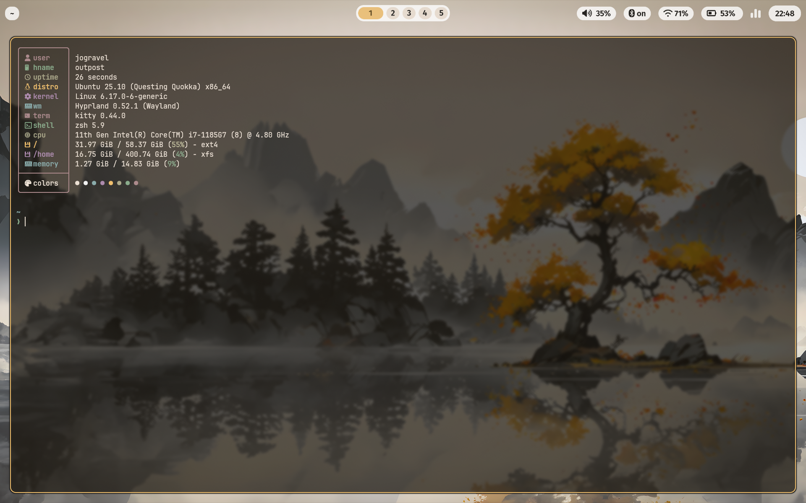

# Dotfiles

This repository contains standalone user configuration files and a Nix Home
Manager setup. `personal`, `work`, and `wm` are Git submodules.

## Checkout

```bash
git clone git@github.com:yobiscus/dotfiles.nix ~/.dotfiles
cd ~/.dotfiles
git submodule update --init --recursive
```

## Setup

### Ubuntu full setup

Run the full bootstrap on Ubuntu:

```bash
./init.sh
```

On the first Home Manager bootstrap, optional modules can be selected with
repeated `-m` flags (`personal`, `work`, or `wm`):

```bash
./init.sh -m personal -m wm
```

The full setup is Ubuntu-only. It runs `apt update` and `apt dist-upgrade`,
installs Nix's multi-user setup when `/nix` is absent, and bootstraps Home
Manager if it is not already installed. It also prepares a Hyprland login
session (installing nixGL and SDDM when needed), purges the apt `curl` and
Firefox packages, and removes the Firefox snap. There is no separate Linux
server bootstrap. Review [init.sh](init.sh) before running the full setup on an
existing system.

The Home Manager flake targets `x86_64-linux` and reads the account name and
home directory from `USER` and `HOME`. Its flake evaluation uses these
environment values, so keep `--impure` when invoking Home Manager. `init.sh`
does not switch an existing Home Manager profile; after setup, use
`scripts/home-manager-switch` to apply configuration changes.

`hms` switches Home Manager and compares the active generation before and
after the switch. Arguments are passed through to Home Manager; dry runs,
help, and version output skip the diff.

`scripts/home-manager-diff-last` repeats the comparison from the last successful
`hms` run, including an unchanged generation. Both store paths are saved in
`${XDG_STATE_HOME:-$HOME/.local/state}/dotfiles/home-manager-last-switch`.
Failed switches, dry runs, help, and version output leave this record unchanged.

Run `hmc`, or `scripts/home-manager-clean`, separately to expire Home Manager
generations older than 30 days, preserving the current generation, then run
`nix-collect-garbage` followed by `nix store optimise`. Use `hmc --dry-run` to
preview expiration and garbage collection without changing the store.

Run `scripts/home-manager-update` to update the Home Manager flake's lock file
and switch using the updated inputs. It uses
`${XDG_CONFIG_HOME:-$HOME/.config}/home-manager`, resolving symlinks to the
configuration directory.

### Dotfiles only

On macOS, non-Ubuntu Linux, or when you only want the config links, run:

```bash
./init.sh --dotfiles-only
```

Optional modules can also be selected in this mode:

```bash
./init.sh --dotfiles-only -m wm
```

This mode does not install Nix or packages. It links the selected files from
`config/` into `~/.config/` and links `~/.zshrc`; it stops if those destinations
already contain files or symlinks. Install required applications separately.
On macOS, this only places the config files; review or adapt them for the apps
you use.

## OpenSSH server

On Ubuntu, [scripts/setup/openssh.sh](scripts/setup/openssh.sh) installs and
enables OpenSSH with key-only authentication, root login disabled, and access
restricted to one non-root account. By default it uses the account running the
script; set `SSH_ADMIN_USER` to choose another account:

```bash
SSH_ADMIN_USER=alice ./scripts/setup/openssh.sh
```

Add connecting devices' public keys to that account's `.ssh/authorized_keys`
before relying on SSH access. The config template is
`scripts/setup/openssh.conf.in`; it disables SSH forwarding. The installer does
not change firewall or router settings, so keep port 22 unforwarded from the
internet.

## Screenshot


